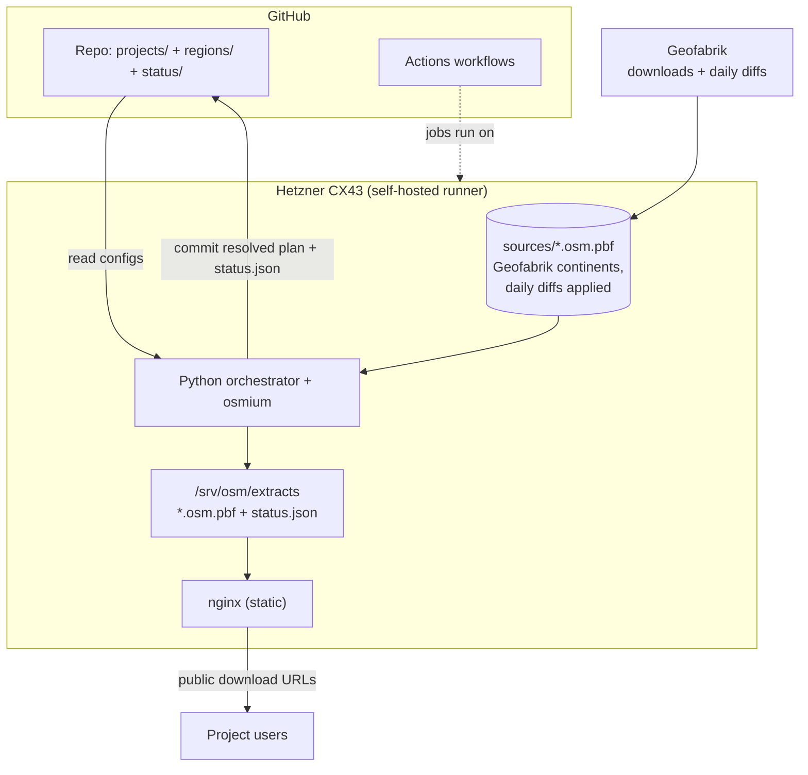

# Plan: OSM PBF filter & extract service

> **Status (2026-10-25).** Decided: we run on **our own Hetzner Cloud CX43**
> (8 vCPU, 16 GB RAM, 160 GB NVMe, ~€16/month, always on, Debian 12) with our
> Ansible role, a self-hosted GitHub Actions runner and **nginx on the server**
> serving the extracts (no S3). Input is **Geofabrik continent extracts**
> ("sources", currently only Europe), kept on disk and updated with Geofabrik's
> daily diffs. The shared FOSSGIS uMap server variant is **paused**
> (§A9). Why this and not the alternatives: [docs/poc-hosting.md](docs/poc-hosting.md).
> The pipeline is implemented and tested locally (Germany as a Europe stand-in:
> 5 projects, 12 osmium steps, ~8.5 min, 5.3 GB peak RAM); it has not run on the
> server yet.

## 1. Goal

Run a service that:

1. Keeps **Geofabrik continent extracts** (OpenStreetMap `.osm.pbf`) on disk and
   **updated daily** from Geofabrik's daily diffs.
2. Produces, **once per day**, a set of small **per-project extracts** — each
   filtered by **area** (a polygon) and by **tags** (osmium key/key=value
   filters).
3. Serves those extracts over **stable public download URLs**, each accompanied
   by machine-readable info about **how old the data is**.
4. Is driven entirely from **this git repository**: you add/edit configs, push,
   and the rest happens automatically — with **as little manual server access as
   possible**.

The chosen way to achieve point 4 is a **self-hosted GitHub Actions runner** on
the server. All logic lives in workflow YAML + the Python orchestrator in this
repo; the only thing that runs "on the server" is the runner agent itself.

---

## 2. Decisions made (and why)

| Topic | Decision |
|---|---|
| CI platform | **GitHub Actions** with a **self-hosted runner** on our server. |
| Server | **Own Hetzner Cloud CX43**, always on, Debian 12 (§3, §A1). Same shape as the paused FOSSGIS setup, so moving later is mostly an inventory change. |
| Input | **Geofabrik continent extracts** ("sources"), kept on disk, updated with Geofabrik's **daily diffs** via pyosmium. Only **Europe** is active; the other continents are listed (commented) in [`regions/regions.yaml`](regions/regions.yaml). |
| Extract storage / serving | **nginx** on the server. Stable URLs + real HTTP headers. **No S3.** **Binaries are not committed to git** — only configs + resolved plan + `status.json` are. |
| Region hierarchy | **Static tree**: sources (continents) at the top, regions below them, defined in `regions/regions.yaml`. Sources and regions are **activated** only when a project needs them. Only **tag filtering is dynamic** (union per active node). |
| World projects | `area: {region: world}`: filtered from every source, then merged (§B3). |
| Orchestrator language | **Python 3** (standard library + PyYAML from apt). Python is on the server anyway for pyosmium. |
| Extract tool | **osmium-tool** (`osmium extract`, `tags-filter`, `merge`, `time-filter`); **pyosmium** for updates. |
| Repo visibility | **Public** — makes the runner hardening in §A3 mandatory. |
| Doc language | English. |

---

## 3. Target environment

- **Server:** Hetzner Cloud **CX43** — 8 shared vCPU, 16 GB RAM, 160 GB NVMe,
  about €16/month plus €0.50/month for the IPv4 address, always on. Debian 12.
  Cost comparison with hourly servers, GitHub-hosted runners and S3 options (all
  considered, none chosen): [docs/poc-hosting.md](docs/poc-hosting.md).
- **Disk:** 160 GB. Europe is ~35 GB; sources are processed one after another
  with cleanup in between, so the box can grow to all continents (~85 GB of
  source files in total) as long as intermediates of one continent fit next to
  them. The disk guard refuses to run below 50 GB free (§A6).
- **RAM:** measured 5.3 GB peak with Germany as the input; 16 GB is the headroom
  for Europe (to be measured on the server).
- **Repo visibility: public.** This makes the self-hosted-runner hardening in
  §A3 **mandatory, not optional**. The GitHub repo settings are done (see
  [README](README.md#github-repository-settings-done-2026-10-25)).

### Still to confirm

- **Public download host + TLS** — which domain serves the extracts, DNS, cert.
  `PUBLIC_BASE` in [extractor/build.py](extractor/build.py) is still a placeholder.
- **Europe on the real box** — runtime and peak RAM of the first full run.
- **Russia / Asia coverage** — check where Geofabrik puts Russia before enabling
  more continents.
- **Runner `sudo` scope** — is the runner allowed a single
  `systemctl reload nginx` (only needed for custom data-age headers, §B5)?

---

## 4. Architecture at a glance



Two halves, covered separately below:

- **Part A — Server provisioning** (the infrastructure).
- **Part B — How the application works** (data + extraction logic).
- **Part C — CI/CD workflows** (the glue that runs B on A).

---

# Part A — Server provisioning

The whole point: do this **once**, then never touch the server again for normal
operation. Provisioning is an **Ansible role** ([`server/ansible/`](server/ansible/README.md))
so it's reproducible. Step-by-step setup: [docs/server-setup.md](docs/server-setup.md).

## A1. The server & disk budget

Our own **Hetzner CX43** (§3), nothing else runs on it. Disk budget:

| Item | Approx. size |
|---|---|
| Europe source (live) | ~35 GB |
| Update headroom (pyosmium rewrites the whole file; old + new coexist) | up to ~35 GB extra |
| Intermediate files in `work/` (regions, tag-filtered files of one source) | tens of GB, transient, cleaned after each source |
| Final per-project extracts in `extracts/` | small–moderate, persistent |

→ **160 GB is comfortable for Europe.** Adding continents adds their file size
(Asia ~15 GB, North America ~19 GB, Africa ~7 GB, South America ~4 GB, …). The
tightest moment is the update of the biggest source, so the daily workflow
**guards on free disk** before the update and before the build (§A6).

## A2. Provisioning — Ansible role

Provisioning lives in the **`osm_extract_service` Ansible role**
([`server/ansible/`](server/ansible/README.md)). It is written so it can later be
reused for the FOSSGIS server (§A9).

The role ([tasks](server/ansible/roles/osm_extract_service/tasks/main.yml)):

| Step | Purpose |
|---|---|
| apt packages: `osmium-tool`, `nginx`, `git`, `jq`, `python3*`, `python3-yaml` | extract/serve/diff toolchain + orchestrator |
| pyosmium venv + `pyosmium-up-to-date` on PATH | apply Geofabrik's daily diffs |
| unprivileged `osmrunner` user | the runner + pipeline run as non-root |
| `/srv/osm/{sources,work,extracts}` | data + work + web root (A4) |
| nginx site ([template](server/ansible/roles/osm_extract_service/templates/nginx-osm-extracts.conf.j2)) | serve extracts; reload only after `nginx -t` |

The GitHub Actions **runner registration** is interactive (a one-time token) and
stays **manual** — see [docs/server-setup.md](docs/server-setup.md).

## A3. Self-hosted GitHub Actions runner ⚠️ security (mandatory)

The repo is **public**. A self-hosted runner executes whatever a workflow tells
it to — so on a public repo this is the highest-risk part of the whole design,
and the mitigations below are **required**, not optional. GitHub itself
recommends *against* self-hosted runners on public repos unless locked down,
because anyone can open a pull request that would otherwise run code on the box.
(The reasoning applies to our own server as much as to a shared one: a compromised
runner owns the box and the published downloads.)

**Install + isolate**
- Run the runner as a **dedicated unprivileged user** (e.g. `osmrunner`) via a
  **systemd service**, registered with the label `osm`
  (`runs-on: [self-hosted, osm]`).
- **No passwordless full `sudo`.** At most one allow-listed
  `systemctl reload nginx` (only if we adopt custom headers, §B5).
- Confine our footprint to `/srv/osm/` with restrictive permissions.

**Never run untrusted PR code**
- ✅ Done 2026-10-25 (see [README](README.md#github-repository-settings-done-2026-10-25)):
  **pull requests can only be opened by collaborators**, and **fork PR workflows
  require approval for all external contributors**.
- Gate the pipeline workflows to safe triggers only: `push` to `main`,
  `schedule`, `workflow_dispatch` — **never** `pull_request` from forks.
- Run any PR-validation (e.g. config linting) on **GitHub-hosted** runners, not
  the self-hosted one. Consider a dedicated runner group so only the pipeline
  workflows can target `osm`.

**Reduce drift / exposure**
- Prefer **ephemeral** runners (clean checkout per job) + auto-update.
- `GITHUB_TOKEN` **read-only by default**; grant `contents: write` only on the
  commit step.
- Firewall: expose only 80/443 (nginx) and SSH; the runner needs **outbound** to
  GitHub only (no inbound).

**Packages & docs (for manual setup / further research)**
**Packages & docs (for manual setup / further research)**
- [Hosting your own runners — how the self-hosted runner feature works (start here)](https://docs.github.com/en/actions/hosting-your-own-runners)
- [Runner application releases](https://github.com/actions/runner/releases) — the
  package to download and install on the server.
- [Adding a self-hosted runner](https://docs.github.com/en/actions/how-tos/manage-runners/self-hosted-runners/add-runners)
- [Running the runner as a systemd service (`svc.sh`)](https://docs.github.com/en/actions/hosting-your-own-runners/managing-self-hosted-runners/configuring-the-self-hosted-runner-application-as-a-service)
- [Self-hosted runners reference](https://docs.github.com/en/actions/reference/runners/self-hosted-runners)
- [Managing self-hosted runners (overview)](https://docs.github.com/en/actions/hosting-your-own-runners/managing-self-hosted-runners)

Install flow (summary): download + unpack the runner package from the releases
link → `./config.sh --url https://github.com/<org>/<repo> --token <token> --labels osm`
→ `sudo ./svc.sh install osmrunner && sudo ./svc.sh start`. (The deps are installed
by the Ansible role (A2); runner registration is interactive and stays manual by
design.)

**Status of these controls (what's enforced where):**
- ✅ Code-enforced now: untrusted code never hits the self-hosted runner
  ([daily.yml](.github/workflows/daily.yml)/[seed-sources.yml](.github/workflows/seed-sources.yml)
  trigger only on `schedule`/`workflow_dispatch`; tests run on GitHub-hosted runners
  in [ci.yml](.github/workflows/ci.yml)); least-privilege token + no persisted
  credentials on the box; one-shot push token.
- ⚙️ Manual one-time (provisioning/repo settings): dedicated unprivileged user, no
  sudo, firewall, and the repo toggle **Settings → Actions → Require approval for
  outside collaborators**.
- 🔜 Open hardening TODOs (§7): prefer an **ephemeral** runner (fresh workspace per
  job) and a dedicated **runner group** so only these workflows can use the `osm`
  label.

## A4. Directory layout on the server

```
/srv/osm/
  sources/
    europe.osm.pbf          # Geofabrik continent extract, daily diffs applied
    europe.state.json       # data_timestamp, sequence_number, update_run_at (written by the orchestrator)
  work/                     # scratch space for intermediate extracts (cleaned after each source)
  extracts/                 # nginx web root  ->  https://<host>/extracts/
    osm-boundary-check/
      latest.osm.pbf        # stable filename, overwritten in place each run
      status.json
    index.json              # listing of all projects + timestamps
```

The repo is checked out into the runner's work dir by `actions/checkout`; the
orchestrator reads configs from there and writes outputs into `/srv/osm/`.

## A5. nginx

Serve only `/srv/osm/extracts` as static files, via a `location /extracts/`
prefix with `root {{ osm_root }}` (config: the role's
[nginx template](server/ansible/roles/osm_extract_service/templates/nginx-osm-extracts.conf.j2)).
A catch-all `location /` returns 404, so the rest of the volume
(`sources/`, `work/`) is never exposed. Other properties, with autoindex off:

- `Last-Modified` (from file mtime = when the extract was produced) — enables
  conditional GETs / caching.
- Resumable large downloads (nginx sends `Accept-Ranges: bytes` for static files by default).
- Long-lived files have stable URLs (see B7), so clients can cache by URL.

(Custom `X-OSM-*` data-age headers are an optional enhancement — see B5.)

## A6. Ongoing maintenance (kept minimal)

- **Disk monitoring** — [scripts/check-disk.sh](scripts/check-disk.sh) fails the
  run if free space drops below 50 GB (default), before the update and before the
  build. Source growth is the main risk.
- **Runner health** — systemd restarts it; GitHub shows it offline if down.
- **No app deploys** — logic changes ship by merging to `main`; the runner picks
  up the new workflow/scripts on the next run.
- **Root tasks** (rare): OS/security updates, the runner agent's own updates, TLS
  issuance/renewal (certbot automates renewal), nginx/Ansible changes, incident
  debugging. We own the box, so these are ours; name a fallback person (§7).

## A7. Observing server load

- **Per-run metrics from the pipeline itself** — the orchestrator records
  timings; extend the runner steps to also capture **peak RAM (max RSS)** and
  **wall time** per osmium step (`/usr/bin/time -v`) and free disk before/after,
  and print them to the Actions log + `$GITHUB_STEP_SUMMARY`. That gives a public,
  per-day record of resource cost without server access.
- **Host monitoring** — Hetzner's graphs (CPU, disk, network) are enough to start
  with; add an alert on disk usage.

## A8. Server hygiene

- osmium steps run strictly one after another (a single osmium process at a time
  caps peak RAM and disk I/O).
- No other tenant, so `nice`/`ionice` is not needed.

## A9. Paused: FOSSGIS uMap server

The first plan was to run on the shared FOSSGIS e.V. uMap server at Hetzner
(~585 GB disk, maintained by the FOSSGIS OSM-server admins, shared with uMap;
planet-based, 87 GB). That variant is **paused** and kept for later. Agreed with
the FOSSGIS admin (2026-10-25): if it comes back, it gets its **own Ansible role
and task setup** in the FOSSGIS repo, separate from the uMap role. It may use
shared services (e.g. nginx) but keeps **its own folders and users**. The
pipeline code is the same; moving is mostly an inventory change. Things that
would need settling then: coexistence with uMap (disk, RAM, I/O; `nice`/`ionice`,
off-peak schedule), the runner setup with their admins, monitoring, a second
root admin, and a subdomain + TLS. Details: [server/ansible/README.md](server/ansible/README.md).

---

# Part B — How the application works

## B1. Source data lifecycle

A **source** is a Geofabrik continent extract
(`https://download.geofabrik.de/<continent>-latest.osm.pbf`) kept at
`/srv/osm/sources/<id>.osm.pbf`. Geofabrik also publishes daily diffs next to it
(`<continent>-updates/`). Only sources that some project needs are touched.
Implemented in [extractor/sources.py](extractor/sources.py):

1. **Seed (automatic if missing, manual to redo).** Download the file with curl,
   verify the `.md5`, swap it in atomically. `python3 -m extractor update`
   seeds a missing source by itself; `python3 -m extractor seed [ids]` (workflow
   [seed-sources.yml](.github/workflows/seed-sources.yml), typed confirmation) forces
   a re-download, e.g. after corruption.

2. **Daily update (automatic).** `python3 -m extractor update` runs
   `pyosmium-up-to-date --server <continent>-updates/` per active source. The
   diffs are capped at ~3 GB per pass and every pass rewrites the file, so a
   long gap takes a few passes (up to 10; progress is kept). Measured for Berlin:
   79 days of diffs in one 16 s pass.

After every update the orchestrator writes `<id>.state.json` with the data's own
timestamp (`osmosis_replication_timestamp` from the pbf header), the sequence
number, and when the update ran. Extracts lose the replication header, so
`status.json` takes the data age from these state files.

## B2. Project configuration

Each project is a folder under [`projects/`](projects/) with a `config.yaml`
declaring an **area** and **tag filters**. Full schema and worked examples are in
[projects/README.md](projects/README.md). Minimal example:

```yaml
# project id = folder name (no `name:` field); full field list — description,
# repository, homepage, contact — is in projects/README.md
description: Administrative boundaries for Germany.
area: { region: germany }
filters:
  - nwr/boundary=administrative
  - nwr/admin_level
```

`area.region` is a region id, a source id (the whole continent), or `world`.

## B3. The static tree + activation

Defined in [`regions/regions.yaml`](regions/regions.yaml): **sources** at the
top (Geofabrik continents), **regions** below them. A region's `parent` is a
source or another region; each region has a polygon.

**Polygon format: GeoJSON** (preferred over osmium's `.poly`), because it's a
standard format we can lint and reuse. osmium accepts GeoJSON for both
`osmium extract -p …` and the multi-extract config. Each polygon **must** be a
GeoJSON `Polygon` or `MultiPolygon` (a `Feature`/`FeatureCollection` wrapping one
is fine) — see "Input validation" below.

Why a tree at all: cutting Germany directly from the Europe file means reading
all of Europe **per project**. Layering (`europe → germany → hessen`) means each
file is read once to cut all its children.

What's **static**: the shapes/parents in `regions.yaml`.
What's **dynamic** (computed each run from the project configs):

- **Activation** — a source or region is used **only if** a project needs it. If
  no project touches Asia, Asia is never downloaded or cut.
- **Tag union** — each intermediate node keeps only the **union** of tags needed
  by the projects beneath it (see B4).

Resolving a project to a chain:

- `area.region: hessen` → follow `parent` links (`hessen → germany → europe`);
  the chain ends at a source.
- `area.region: europe` (a source id) → the whole source, filtered.
- `area.region: world` → one chain per source (see below).
- `area.polygon: ./x.geojson` → validated, but **not scheduled yet** (skipped
  with a warning). Auto-detecting the parent by bounding box is a later step.

**World projects.** A project with `area: {region: world}` is filtered from
**every** source, one source at a time, and the pieces are merged:
`osmium merge --with-history` followed by `osmium time-filter`. Continent files
overlap, so the same object can appear in two files in different versions; this
keeps the newest version of each (workaround for
[osmium-tool#197](https://github.com/osmcode/osmium-tool/issues/197); idea from
[k-yle/OpenSeaMap-vector](https://github.com/k-yle/OpenSeaMap-vector/blob/main/.github/workflows/planet.yml)).
With only one active source there is nothing to merge. Tested with two sources: no
duplicates.

## B4. The orchestrator (Python)

Implemented in [`extractor/`](extractor/build.py): [build.py](extractor/build.py) (entry),
[config.py](extractor/config.py) (load + validate), [sources.py](extractor/sources.py)
(seed + update), [geojson.py](extractor/geojson.py), [tags.py](extractor/tags.py)
(tag union), [plan.py](extractor/plan.py) (DAG + steps). Pure planning + shelling out
to `osmium`. CLI:

```bash
python3 -m extractor update              # download missing sources, apply daily diffs
python3 -m extractor build [--dry-run]   # plan, run osmium, write status; --dry-run only writes plan.json
python3 -m extractor seed [ids]          # re-download sources from scratch
```

`build` does:

**1. Load & validate** all `projects/*/config.yaml` + `regions/regions.yaml` and
every referenced GeoJSON polygon — see **Input validation** below. Invalid inputs
are **skipped**, not fatal.

**2. Build the active DAG.** For each project, compute its chain
`source → … → project`. Union all chains into one forest (one tree per source);
drop unused branches.

**3. Compute the tag union per node.** For every intermediate node, merge the tag
filters of all descendant projects. Resolution rules:

- Parse each filter into `(object-types, key, values | ALL)`.
- Group by `key`.
- If **any** descendant requests the **whole key** (`nwr/amenity`), the node
  keeps the whole key (broadest wins). Otherwise keep the **union of values**
  (`nwr/amenity=playground,kindergarten`).
- **Object types:** union them per key (`n/x` + `w/x` → `nw/x`). Safe default is
  to broaden intermediate nodes to `nwr` so referenced geometry isn't dropped.
- A project with **no filters** (wants everything) makes its whole branch
  **unfiltered** — the optimisation is skipped for that branch.
- A source file itself is never tag-filtered as a whole; the first filter happens
  on its children.

> Example from the sample projects: Germany needs `boundary` + `admin_level`,
> France needs `amenity=playground`. The `germany` and `france` nodes are cut
> from Europe in one pass, then each is tag-filtered to the union of what its
> projects need.

**4. Emit a resolved plan** (`plan.json`) — the concrete osmium steps, the tag
unions per node, and which sources/regions were activated. **This gets
committed** so the exact thing that ran is reviewable in git history.

**5. Execute, one source at a time.** For each source: one multi-extract per
parent (each parent file is read once), tag-filter each child to its union, run
the project leaves, then **delete that source's intermediates** before the next
source starts. World projects write one piece per source into `work/`; a final
`merge` step combines them. Steps run strictly sequentially.

```bash
# One read of europe -> germany + france (geometry only):
osmium extract --config europe.extracts.json --strategy smart europe.osm.pbf

# Tag-filter each child to its union. osmium INCLUDES referenced objects by
# default (so ways/relations keep their geometry); -R/--omit-referenced disables that.
osmium tags-filter germany.osm.pbf nwr/boundary=administrative nwr/admin_level \
  -o germany.filtered.osm.pbf

# Final per-project tag-filter to its exact tags:
osmium tags-filter germany.filtered.osm.pbf nwr/boundary=administrative nwr/admin_level \
  -o /srv/osm/extracts/osm-boundary-check/latest.osm.pbf

# World projects, merging the pieces of several sources:
osmium merge --with-history europe-piece.osm.pbf asia-piece.osm.pbf -o merged.osm.pbf
osmium time-filter merged.osm.pbf -o /srv/osm/extracts/<project>/latest.osm.pbf
```

Notes:
- `--strategy` cuts geometry: osmium's default is `complete_ways` (2 passes);
  `smart` (3 passes, a bit more RAM) also completes multipolygon **relations**, so
  it's the safer default for boundary projects. The strongest strategy any
  project under a parent needs wins (see §B8).
- osmium tags-filter **includes referenced objects by default** (up to 3 passes,
  keeps ID tables in RAM) so results build valid geometry; `-R/--omit-referenced`
  is the cheaper 1-pass mode that drops them. The per-project `add_referenced`
  knob (default `true`) maps to the default include; `false` adds `-R`. ⚠️ There is
  no `--add-referenced` flag.
- The multi-extract `--config` JSON is **generated** by the orchestrator from the
  active nodes; polygons are referenced as **GeoJSON** files.
- `build` refuses to run if an active source file is missing (run `update`
  first), and fails if no valid project is left, rather than publishing an empty
  index.

**Input validation (fail-soft).** Before building anything, the orchestrator
checks each source/region/project:

- the YAML parses and has the required fields; ids are valid (`world` is reserved);
  a source url must be an https `…-latest.osm.pbf` download;
- a region's parent chain reaches a source; its GeoJSON exists and its geometry is
  a **`Polygon` or `MultiPolygon`** (unwrapping a `Feature`/`FeatureCollection`);
  anything else (point, line, empty, malformed JSON) is rejected.

Invalid items are **skipped** so one broken config can't break everyone else's
extract. Every skip is reported as a **GitHub Actions error annotation**
(`::error file=…::`, which highlights the offending file in the run) plus a line
in the run summary (§C1).

**Implementation status (pre-alpha).** The planning logic is unit-tested with
Python's built-in `unittest` (`python3 -m unittest`). The full osmium path has run
end-to-end **locally**: Germany as a Europe stand-in (5 projects, 12 osmium steps,
~8.5 min, 5.3 GB peak RAM), a two-source merge (no duplicates), and a real
Geofabrik seed + daily-diff update for Berlin. Not yet run on the server.

## B5. Output, status files, HTTP headers

Next to every extract, write `status.json` (shape: `write_status` in
[extractor/build.py](extractor/build.py)):

```json
{
  "project": "osm-boundary-check",
  "description": "Administrative boundaries for Germany.",
  "repository": "https://github.com/example-org/osm-boundary-check",
  "homepage": "https://osm-boundary-check.example.org",
  "contact": "example-org",
  "file": "latest.osm.pbf",
  "size_bytes": 12345678,
  "sha256": "…",
  "area": { "region": "germany" },
  "filters": ["nwr/boundary=administrative", "nwr/admin_level"],
  "pipeline": ["europe", "germany"],

  "data_timestamp": "2026-10-24T20:20:00Z",   // oldest data_timestamp of the project's sources
  "sources": {
    "europe": {
      "url": "https://download.geofabrik.de/europe-latest.osm.pbf",
      "data_timestamp": "2026-10-24T20:20:00Z",
      "sequence_number": 4321,
      "update_run_at": "2026-10-25T02:20:00Z"
    }
  },
  "extract_run_at": "2026-10-25T02:40:00Z",     // when this extract was produced
  "extract_duration_seconds": 42,

  "download_url": "https://<host>/extracts/osm-boundary-check/latest.osm.pbf"
}
```

For a world project, `pipeline` lists every source plus `"merge"`, and `sources`
has one entry per source. This covers every "how old is the data" question: the
data's own date (the oldest of the sources it is built from), each source's last
update run, the last extract run, and per-extract timing. The
`description`/`repository`/`homepage`/`contact` fields are copied straight from
the project's `config.yaml`, so every download is traceable to an owner.

A top-level `extracts/index.json` lists all projects with their timestamps.

**HTTP-header strategy (pragmatic):**
- MVP: `Last-Modified` (= extract time, from file mtime) + the sidecar
  `status.json` as the authoritative source of all dates.
- Optional enhancement: serve custom `X-OSM-Data-Timestamp` / `X-OSM-Extract-At`
  headers. Static nginx can't easily emit per-file custom headers, so this needs
  either a generated `map`/`location` snippet reloaded each run (`sudo systemctl
  reload nginx` — a tiny, scriptable server touch) or a thin dynamic layer.
  Deferred unless required, since `status.json` already carries the data.

## B6. Git traceability — what is committed

Committed every run (so git history *is* the audit log):

- `projects/**` and `regions/**` — the inputs.
- `plan.json` (the resolved plan) — exactly what was computed.
- `status/**` (a copy of each `status.json` + `index.json`) — what was produced
  and how old it was.

**Not** committed: the `.osm.pbf` binaries (served by nginx instead; see
[.gitignore](.gitignore)). A daily commit of multi-hundred-MB binaries would
bloat the repo without adding traceability the metadata doesn't already give.

## B7. Download URLs

Stable, predictable, documentable:

```
https://<host>/extracts/<project-id>/latest.osm.pbf           # the data
https://<host>/extracts/<project-id>/status.json              # the metadata
https://<host>/extracts/index.json                            # everything
```

The data file is always `latest.osm.pbf` (overwritten in place each run), so the
URL is stable across runs — consumers hard-code it and check `status.json` /
`Last-Modified` for freshness.

## B8. Performance & RAM

**Region filter vs. tag filter — which is smarter?** They are different osmium
tools and not either/or; **we use both, in a deliberate order**:

- **Region (geometry) filtering first, hierarchically.** This is osmium's own
  recommendation for splitting a big file: *"first create several larger extracts
  and then split them again and again into smaller pieces"*
  ([osmium-extract docs](https://docs.osmcode.org/osmium/latest/osmium-extract.html)).
  Starting from continent files instead of the planet already did the first split
  for us.
- **Tag filtering reduces each region to the tags projects asked for.** Because
  osmium can't geo-cut and tag-filter in one command, these are separate passes.
- **Open optimisation:** for very *sparse* tag sets a **tag-filter pass before the
  region cuts** can shrink the source a lot up front. It's not always a win
  (boundary relations pull in many referenced members), so it's a **benchmark
  TODO** (§7), not a default.

**Will the RAM be enough?** Very likely yes — osmium **streams** the file; RAM is
driven by **ID bitmaps**, roughly `#extracts × (highest_node_id / 8)` for the
`simple` strategy, **~2×** for `complete_ways`, and a bit more for `smart`
([docs](https://docs.osmcode.org/osmium/latest/osmium-extract.html)); tags-filter
keeps "tables of object IDs it needs" (and with `-R/--omit-referenced` keeps
*none*). Measured: 5.3 GB peak for the Germany run (above). Europe on 16 GB still
needs a real measurement.

**Strategy choice (memory vs. completeness):** osmium's default is `complete_ways`
(2 passes); `smart` (3 passes, a bit more RAM) also completes **relations**, which
boundary projects need — so we use the strongest strategy any project under a
parent requests. Projects that don't need relations can set `complete_ways` to
use less RAM.

**Measured (first benchmark).** A Dockerized run on the 4.4 GB Germany extract
([experiments/performance/](experiments/performance/), report:
[report.html](experiments/performance/report.html) — open locally) found: osmium
`extract` peaks at **~4 GB RAM** (driven by the global node-ID index, not output
size); `smart` costs only ~12 s / ~0.2 GB more than `complete_ways` and completes
relations (so it's the right boundary default); `tags-filter` **with** referenced
objects ≈ 2.2 GB vs **`-R`** ≈ 0.25 GB (but `-R` drops geometry); and for our
sparse tags, tag-then-region was marginally faster than region-then-tag. The run
is **disk-I/O bound** (a few full passes).

---

# Part C — CI/CD workflows (GitHub Actions)

The pipeline workflows ([daily.yml](.github/workflows/daily.yml),
[seed-sources.yml](.github/workflows/seed-sources.yml)) run on
`runs-on: [self-hosted, osm]` with a shared `concurrency` group so two runs never
touch the sources at once. Unit tests ([ci.yml](.github/workflows/ci.yml)) run on
**GitHub-hosted** runners, never the self-hosted one (§A3).

## C1. Logging & observability

- Every step streams to the **Actions log** (publicly viewable, the repo is
  public) — this satisfies "logging must be visible in Actions".
- The orchestrator writes a human summary to **`$GITHUB_STEP_SUMMARY`**:
  sources and regions activated, project and step counts, and **any
  skipped/invalid inputs**.
- Validation failures (§B4) are emitted as **`::error file=…::` annotations** so
  they surface at the top of the run and on the offending file.
- The committed `plan.json` + `status/**` give a durable record outside the logs.

## C2. [`daily.yml`](.github/workflows/daily.yml) — update + extract (scheduled)

Runs at **02:17 UTC** (Geofabrik's daily diffs cover data up to ~20:20 UTC and are
published soon after; the odd minute avoids the top-of-hour cron rush) and on
manual dispatch. Job timeout 600 min. Steps, in order:

1. checkout (no persisted credentials)
2. `./scripts/check-disk.sh` (an update rewrites a whole source file)
3. `python3 -m extractor update`
4. `./scripts/check-disk.sh` (intermediates need room too)
5. `python3 -m extractor build`
6. clean `work/` (runs even on failure)
7. `./scripts/commit-results.sh` — commits `plan.json` + `status/` (the only step
   with `contents: write`)

A single workflow is simpler than chaining update and extract via `workflow_run`,
given one runner with local data.

## C3. [`seed-sources.yml`](.github/workflows/seed-sources.yml) — full re-download (manual only)

`workflow_dispatch` with a required input `confirm` that must be `reseed`, and an
optional `sources` input (space-separated ids; empty = every source in use). Runs
the disk guard, then `python3 -m extractor seed $SOURCES`: download, verify md5,
atomic swap. The daily job seeds a missing source by itself, so this is only for a
corrupt or hopelessly outdated file.

---

## 5. Repository layout & built files

Links point at the actual files in this repo.

**Docs**
- [PLAN.md](PLAN.md) — this document
- [README.md](README.md) · [ZUSAMMENFASSUNG.de.md](ZUSAMMENFASSUNG.de.md) — German one-pager
- [docs/poc-hosting.md](docs/poc-hosting.md) — hosting research and the decision
- [docs/server-setup.md](docs/server-setup.md) — step-by-step server setup
- [docs/ci-compute-alternatives.md](docs/ci-compute-alternatives.md) — older CI/compute research (full planet)

**Inputs — configuration (committed by hand)**
- [projects/](projects/README.md) — one folder per project (schema + conventions in the README)
  - [osm-boundary-check/config.yaml](projects/osm-boundary-check/config.yaml) — illustrative (admin boundaries, Germany)
  - [playgrounds-france/config.yaml](projects/playgrounds-france/config.yaml) — illustrative (playgrounds, France)
  - [spieli/config.yaml](projects/spieli/config.yaml) — **real** (playground POIs, Hessen)
  - [osm-boundary-checker-germany/config.yaml](projects/osm-boundary-checker-germany/config.yaml) — **real** (admin + postal-code boundaries, Germany)
  - [test-neukoelln/config.yaml](projects/test-neukoelln/config.yaml) — test (spieli tags, Berlin-Neukölln)
- [regions/regions.yaml](regions/regions.yaml) — sources and regions ([README](regions/README.md))
  - [regions/polygons/](regions/polygons/README.md) — GeoJSON Polygon/MultiPolygon shapes (Germany, France, Hessen, Neukölln)

**Orchestrator — Python, pre-alpha** (`python3 -m extractor update|build|seed`)
- [extractor/build.py](extractor/build.py) — entry point and CLI: load → plan → write `plan.json` → run osmium → write status files
- [extractor/sources.py](extractor/sources.py) — seed + daily-diff update of the source files, state files
- [extractor/config.py](extractor/config.py) — load + fail-soft validate source/region/project configs (IO; PyYAML)
- [extractor/geojson.py](extractor/geojson.py) — pure GeoJSON polygon validation
- [extractor/tags.py](extractor/tags.py) — pure osmium tags-filter parsing + per-node **tag union**
- [extractor/plan.py](extractor/plan.py) — pure planning: chains, activation, ordered osmium steps (incl. world merge)
- [extractor/github.py](extractor/github.py) — Actions error/warning annotations + step summary
- [extractor/types.py](extractor/types.py) — shared data types + id validation
- Tests (`python3 -m unittest`, standard library only): [tests/](tests/)

**Server provisioning** (Part A) — Ansible role [server/ansible/](server/ansible/README.md)
- [roles/osm_extract_service/tasks/main.yml](server/ansible/roles/osm_extract_service/tasks/main.yml) — packages, user, dirs, nginx
- [.../defaults/main.yml](server/ansible/roles/osm_extract_service/defaults/main.yml) — variables (host, paths, packages)
- [.../templates/nginx-osm-extracts.conf.j2](server/ansible/roles/osm_extract_service/templates/nginx-osm-extracts.conf.j2) — static download host
- [playbook.example.yml](server/ansible/playbook.example.yml) · [inventory.example.ini](server/ansible/inventory.example.ini)

**CI/CD** (Part C)
- [.github/workflows/ci.yml](.github/workflows/ci.yml) — tests (`python3 -m unittest`) on **GitHub-hosted** runners (never self-hosted)
- [.github/workflows/daily.yml](.github/workflows/daily.yml) — update + build + commit (self-hosted)
- [.github/workflows/seed-sources.yml](.github/workflows/seed-sources.yml) — manual full re-download of sources
- Scripts: [commit-results.sh](scripts/commit-results.sh) · [check-disk.sh](scripts/check-disk.sh)

**Generated each run (committed metadata, never binaries)**
- `status/` — per-project `status.json` + `index.json`
- `plan.json` — the resolved plan (also produced by `build --dry-run`)

---

## 6. Phased implementation

1. **Local proof (done).** Planner, osmium execution, source update and world
   merge run locally against Geofabrik files.
2. **Server MVP.** Provision the CX43 with the Ansible role, register the runner,
   seed Europe, run `daily.yml` once by hand: update → build → nginx download →
   `status.json`. Set the real `PUBLIC_BASE` and TLS.
3. **Measure and tune.** Peak RAM and runtime for Europe, per-step metrics in the
   step summary (§A7).
4. **More continents.** Enable sources in `regions.yaml` one by one, up to the
   whole world; first world project to exercise the merge for real.
5. **Polish.** Custom-polygon projects with auto-detected parents, optional custom
   HTTP headers, runner hardening (§A3).

---

## 7. Open questions

1. **Download host + TLS** — which domain, who manages DNS and the cert?
2. **Europe on the real box** — runtime and peak RAM (§B8); does 16 GB hold with
   `smart` and several projects?
3. **Runner hardening** — adopt an ephemeral runner + dedicated runner group (§A3).
4. **Fallback admin** — name a second person with root on the box.
5. **Load metrics** — add per-run RAM/time/disk to the pipeline (§A7).
6. **Tag filter before region cut** — benchmark on a continent file (§B8).
7. **More continents** — check Russia's coverage in Geofabrik's tree; disk plan
   once North America and Asia are on.
8. **Country layer depth** — always include a country layer, or only add one when
   ≥N projects share a country (to avoid pointless intermediate extracts)?
9. **Custom polygons** — do projects need arbitrary polygons (cities, custom
   boundaries), or always a named region? (Currently validated but skipped — §B3.)
10. **HTTP data-age headers** — is `Last-Modified` + `status.json` enough, or do
    we need the custom `X-OSM-*` headers (which add a small nginx-reload step)?
11. **FOSSGIS server** — when to revisit the paused variant (§A9).
