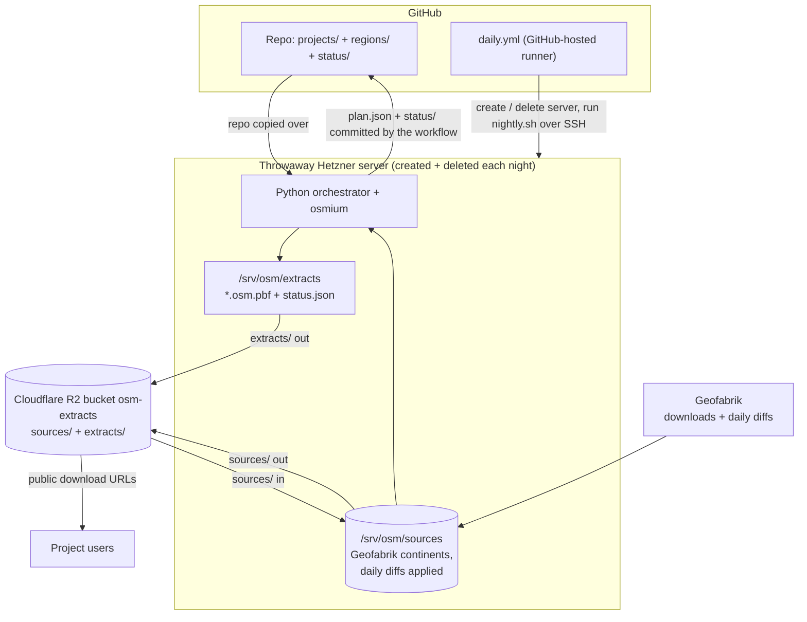

# Plan: OSM PBF filter & extract service

> **Status (2026-10-26).** Decided: no always-on server (CPX42 would be ~€83/month).
> Each night `daily.yml` runs on a normal GitHub-hosted runner, creates a
> **throwaway Hetzner server**, installs the toolchain with our Ansible role,
> runs the update + build, pushes everything to **Cloudflare R2** (bucket
> `osm-extracts`, public via r2.dev for now) and **always deletes the server**.
> Input is **Geofabrik continent extracts** ("sources", currently only Europe),
> kept in R2 and updated with Geofabrik's daily diffs. Cost: ~€4–8/month server
> + ~$1–2/month R2. The shared FOSSGIS uMap server variant is **paused** (§A8).
> Why this and not the alternatives: [docs/poc-hosting.md](docs/poc-hosting.md).
> Tested locally: Germany as a Europe stand-in (5 projects, 12 osmium steps,
> ~8.5 min, 5.3 GB peak RAM) and the whole `nightly.sh` flow with a local folder
> standing in for R2 (Berlin). The Hetzner and R2 parts have **not run for real
> yet**; start with [docs/setup.md](docs/setup.md).

## 1. Goal

Run a service that:

1. Keeps **Geofabrik continent extracts** (OpenStreetMap `.osm.pbf`) in R2 and
   **updated daily** from Geofabrik's daily diffs.
2. Produces, **once per day**, a set of small **per-project extracts** — each
   filtered by **area** (a polygon) and by **tags** (osmium key/key=value
   filters).
3. Serves those extracts over **stable public download URLs**, each accompanied
   by machine-readable info about **how old the data is**.
4. Is driven entirely from **this git repository**: you add/edit configs, push,
   and the rest happens automatically — with **as little manual server access as
   possible**.

The chosen way to achieve point 4 is a **nightly GitHub Actions workflow** that
creates a throwaway Hetzner server, runs the pipeline on it with sources and
extracts kept in Cloudflare R2, and deletes the server again. All logic lives in
workflow YAML + the Python orchestrator in this repo.

---

## 2. Decisions made (and why)

| Topic | Decision |
|---|---|
| CI platform | **GitHub Actions** on a normal **GitHub-hosted runner**. No self-hosted runner. |
| Compute | **Throwaway Hetzner Cloud server** created and deleted by `daily.yml` each night (cpx42 / ccx33 / cpx52 across nbg1 / hel1 / fsn1, whichever is available), toolchain installed by our Ansible role (§A1, §A2). Always-on server rejected: CPX42 is ~€83/month (decision 2026-10-26). |
| Input | **Geofabrik continent extracts** ("sources"), kept in R2 between nights, updated with Geofabrik's **daily diffs** via pyosmium. Only **Europe** is active; the other continents are listed (commented) in [`regions/regions.yaml`](regions/regions.yaml). |
| Storage + delivery | **Cloudflare R2**, bucket `osm-extracts` (prefixes `sources/`, `extracts/`), public via r2.dev for now, custom domain later. **No nginx** in this model. **Binaries are not committed to git** — only configs + resolved plan + `status.json` are. |
| Secrets | `HCLOUD_TOKEN`, `SSH_PRIVATE_KEY`, `R2_ACCESS_KEY_ID`, `R2_SECRET_ACCESS_KEY`, `R2_ENDPOINT` as GitHub secrets. Everything else is a code constant. |
| Region hierarchy | **Static tree**: sources (continents) at the top, regions below them, defined in `regions/regions.yaml`. Sources and regions are **activated** only when a project needs them. Only **tag filtering is dynamic** (union per active node). |
| World projects | `area: {region: world}`: filtered from every source, then merged (§B3). |
| Orchestrator language | **Python 3** (standard library + PyYAML from apt). Python is on the server anyway for pyosmium. |
| Extract tool | **osmium-tool** (`osmium extract`, `tags-filter`, `merge`, `time-filter`); **pyosmium** for updates. |
| Long-lived server | Not used now. The role's `osm_serve: true` mode (nginx, ufw, certbot) is kept for it, e.g. FOSSGIS later (paused, §A8). |
| Repo visibility | **Public** — makes the secret handling in §A3 mandatory. |
| Doc language | English. |

---

## 3. Target environment

- **Compute:** a throwaway **Hetzner Cloud** server per night, Debian 12, created
  and deleted by the workflow (§A1). Candidates: cpx42 (8 vCPU / 16 GB / 320 GB,
  ~€0.13/h), ccx33, cpx52. About €4–8/month for 1–2 hours a night. Cost comparison
  and why not an always-on server: [docs/poc-hosting.md](docs/poc-hosting.md).
- **Storage + delivery:** **Cloudflare R2** bucket `osm-extracts` (~$1–2/month,
  free egress), public via r2.dev for now (§A5).
- **Disk:** 240–480 GB depending on the candidate. Europe is ~35 GB; sources are
  processed one after another with cleanup in between, so all continents (~85 GB
  of source files in total) fit as long as intermediates of one continent fit next
  to them. The disk guard refuses to run below 50 GB free (§A6).
- **RAM:** measured 5.3 GB peak with Germany as the input; 16 GB is the headroom
  for Europe (to be measured on a real run).
- **Repo visibility: public.** Secrets live in GitHub, so the PR restrictions in
  §A3 are **mandatory**. The GitHub repo settings are done (see
  [README](README.md#github-repository-settings-done-2026-10-25)).

### Still to confirm

- **First real run** — the Hetzner and R2 parts have not run for real yet (the
  whole `nightly.sh` flow ran locally with a folder standing in for R2).
- **Public download URL** — `PUBLIC_BASE` in [extractor/build.py](extractor/build.py)
  is still a placeholder until the bucket's URL exists; custom domain later.
- **Europe on a real server** — runtime and peak RAM of the first full run, and
  which server types Hetzner actually has available.
- **Russia / Asia coverage** — check where Geofabrik puts Russia before enabling
  more continents.

---

## 4. Architecture at a glance



Three parts, covered separately below:

- **Part A — Nightly throwaway server + R2** (the infrastructure).
- **Part B — How the application works** (data + extraction logic).
- **Part C — CI/CD workflow** (the glue that runs B on A).

---

# Part A — Nightly throwaway server + R2

No server runs permanently. Each night [daily.yml](.github/workflows/daily.yml)
creates a Hetzner Cloud server, does the work, and deletes it. What persists
between nights lives in **Cloudflare R2**. Provisioning is an **Ansible role**
([`server/ansible/`](server/ansible/README.md)) so it's reproducible. Step-by-step
setup: [docs/setup.md](docs/setup.md).

## A1. The server & disk budget

A throwaway **Hetzner Cloud** server (Debian 12), ~€0.13/h, alive 1–2 hours a
night. `nightly-create.yml` tries these candidates in order and takes the first
one Hetzner accepts (types are often temporarily unavailable):

| Candidate | Spec |
|---|---|
| cpx42 in nbg1, then hel1 | 8 vCPU / 16 GB RAM / 320 GB |
| ccx33 in fsn1, then nbg1 | dedicated 8 vCPU / 32 GB RAM / 240 GB |
| cpx52 in nbg1 | 12 vCPU / 24 GB RAM / 480 GB |

Disk budget on the server during a run:

| Item | Approx. size |
|---|---|
| Europe source (fetched from R2, then updated) | ~35 GB |
| Update headroom (pyosmium rewrites the whole file; old + new coexist) | up to ~35 GB extra |
| Intermediate files in `work/` (regions, tag-filtered files of one source) | tens of GB, transient, cleaned after each source |
| Final per-project extracts in `extracts/` | small–moderate |

→ **240–480 GB is comfortable for Europe.** Adding continents adds their file size
(Asia ~15 GB, North America ~19 GB, Africa ~7 GB, South America ~4 GB, …) and
transfer time to and from R2. The workflow **guards on free disk** before the
update and before the build (§A6).

## A2. Provisioning — Ansible role

The **`osm_extract_service` role**
([tasks](server/ansible/roles/osm_extract_service/tasks/main.yml)) has two modes:

| Step | `osm_serve: false` (nightly) | `osm_serve: true` (long-lived) |
|---|---|---|
| apt: `osmium-tool`, `python3-pyosmium`, `python3-yaml`, `rclone`, `rsync`, `git`, `jq`, `curl` | yes | yes |
| `pyosmium-up-to-date` on PATH | yes | yes |
| unprivileged `osmrunner` user (no sudo) | yes | yes |
| `/srv/osm/{sources,work,extracts}` | yes | yes |
| nginx site, ufw, certbot, unattended-upgrades | no | yes |

`daily.yml` always uses the nightly mode. The long-lived mode is kept for a server
that serves the files itself (e.g. FOSSGIS, §A8), via
[playbook.example.yml](server/ansible/playbook.example.yml). Details and commands:
[server/ansible/README.md](server/ansible/README.md).

## A3. Security (public repo, secrets on a GitHub-hosted runner)

There is **no self-hosted runner**: the workflow runs on a GitHub-hosted runner,
and the throwaway server is created and deleted per run. So a pull request cannot
run code on a machine of ours. What matters instead is that **untrusted code never
gets the secrets**:

- ✅ Done 2026-10-25 (see [README](README.md#github-repository-settings-done-2026-10-25)):
  **pull requests can only be opened by collaborators**, and **fork PR workflows
  require approval for all external contributors**. GitHub also withholds secrets
  from fork PRs by default.
- `daily.yml` triggers only on `schedule` and `workflow_dispatch`, never on
  `pull_request`; tests run separately in [ci.yml](.github/workflows/ci.yml).
- Secrets (`HCLOUD_TOKEN`, `SSH_PRIVATE_KEY`, R2 keys) are real secrets in GitHub.
  The R2 token is scoped to the one bucket; the Hetzner token to one project.
  The R2 config is written to the server over stdin, not on a command line.
- `GITHUB_TOKEN` is read-only by default; `contents: write` only on the job that
  commits `plan.json` + `status/`, with no persisted credentials.
- The server accepts only SSH (Cloud Firewall), runs the pipeline as the
  unprivileged `osmrunner` (no sudo), and lives about an hour. Compromising it
  means access to the R2 key of that run, so keep the bucket token narrow.
- Anyone with write access can change workflows, so keep the collaborator list to
  people you'd trust with the secrets.

## A4. Directory layout

On the throwaway server (`/srv/osm`; rebuilt every night from R2):

```
/srv/osm/
  repo/                     # the repo, rsynced by the workflow
  sources/
    europe.osm.pbf          # fetched from R2, daily diffs applied, pushed back
    europe.state.json       # data_timestamp, sequence_number, update_run_at
  work/                     # scratch space for intermediate extracts (cleaned after each source)
  extracts/
    osm-boundary-check/
      latest.osm.pbf        # stable filename
      status.json
    index.json              # listing of all projects + timestamps
```

In R2 (bucket `osm-extracts`): `sources/` (private working copy of the continent
files and state files) and `extracts/` (same layout as above, public).

## A5. Storage and delivery: Cloudflare R2

- **Bucket** `osm-extracts` with the prefixes `sources/` and `extracts/`. Public
  access via r2.dev for now; a custom domain can be added later. Only the
  `extracts/` URLs are meant to be shared.
- **Why R2 and not a Hetzner Volume:** no location lock (the server can start
  wherever a type is available), ~$0.015/GB-month, free egress — we move the
  continent files every night.
- **Why R2 and not Hetzner Object Storage:** €6.49+ base fee, and its 1 TB of
  included traffic would be used up by our own nightly transfers. Same S3 API, so
  switching later is just endpoint + keys.
- Transfers use `rclone` with `copy` (not `sync`); the push of `sources/` happens
  right after the update so a failing build doesn't lose it.

## A6. Ongoing maintenance (kept minimal)

- **Disk guard** — [scripts/check-disk.sh](scripts/check-disk.sh) fails the run if
  free space drops below 50 GB (default), before the update and before the build.
- **No leftovers** — the first step of every run deletes servers labelled
  `project=osm-pbf-filter-service,role=nightly`, and the last step runs
  `if: always()`. Still check the Hetzner console now and then (and set a billing
  alert).
- **No app deploys** — logic changes ship by merging to `main`; the repo is copied
  onto a fresh server each night.
- **Hetzner prices and availability change** — re-check before relying on the
  cost numbers; adjust the candidates in `nightly-create.yml`.

## A7. Observing server load

- **Per-run metrics from the pipeline itself** — the orchestrator records
  timings; extend the run to also capture **peak RAM (max RSS)** and **wall time**
  per osmium step (`/usr/bin/time -v`) and free disk before/after, and print them
  to the Actions log + `$GITHUB_STEP_SUMMARY`. That gives a public, per-day record
  of resource cost.
- The server is gone after the run, so Hetzner's graphs are not useful; the
  pipeline output is the record.

## A8. Paused: FOSSGIS uMap server, and the long-lived path

The first plan was to run on the shared FOSSGIS e.V. uMap server at Hetzner
(~585 GB disk, maintained by the FOSSGIS OSM-server admins, shared with uMap;
planet-based, 87 GB). That variant is **paused** and kept for later. Agreed with
the FOSSGIS admin (2026-10-25): if it comes back, it gets its **own Ansible role
and task setup** in the FOSSGIS repo, separate from the uMap role. It may use
shared services (e.g. nginx) but keeps **its own folders and users**.

The role's `osm_serve: true` mode is the starting point for any long-lived server
that serves the files itself. Things that would need settling then: how the
pipeline is triggered (a self-hosted runner there would need the hardening for
public repos; or keep the nightly flow and only publish to that server),
coexistence with uMap (disk, RAM, I/O; `nice`/`ionice`, off-peak schedule),
monitoring, a second root admin, and a subdomain + TLS. Details:
[server/ansible/README.md](server/ansible/README.md).

> **Rejected: an always-on Hetzner server** (decision 2026-10-25, reversed
> 2026-10-26): the cheap CX line is "currently not available" and CPX42
> (8 vCPU / 16 GB) is about €83/month incl. VAT. Reasons and costs:
> [docs/poc-hosting.md](docs/poc-hosting.md).

---

---

# Part B — How the application works

## B1. Source data lifecycle

A **source** is a Geofabrik continent extract
(`https://download.geofabrik.de/<continent>-latest.osm.pbf`) kept at
`/srv/osm/sources/<id>.osm.pbf`. Geofabrik also publishes daily diffs next to it
(`<continent>-updates/`). Only sources that some project needs are touched.
Implemented in [extractor/sources.py](extractor/sources.py):

1. **Seed (automatic if missing, manual to redo).** Download the file with curl,
   verify the `.md5`, swap it in atomically. `python3 -m extractor update`
   seeds a missing source by itself; `python3 -m extractor seed [ids]` forces a
   re-download, e.g. after corruption. In the nightly run that is the `reseed`
   input of `daily.yml` (§C2).

2. **Daily update (automatic).** `python3 -m extractor update` runs
   `pyosmium-up-to-date --server <continent>-updates/` per active source. The
   diffs are capped at ~3 GB per pass and every pass rewrites the file, so a
   long gap takes a few passes (up to 10; progress is kept). Measured for Berlin:
   79 days of diffs in one 16 s pass.

After every update the orchestrator writes `<id>.state.json` with the data's own
timestamp (`osmosis_replication_timestamp` from the pbf header), the sequence
number, and when the update ran. Extracts lose the replication header, so
`status.json` takes the data age from these state files.

## B2. Project configuration

Each project is a folder under [`projects/`](projects/) with a `config.yaml`
declaring an **area** and **tag filters**. Full schema and worked examples are in
[projects/README.md](projects/README.md). Minimal example:

```yaml
# project id = folder name (no `name:` field); full field list — description,
# repository, homepage, contact — is in projects/README.md
description: Administrative boundaries for Germany.
area: { region: germany }
filters:
  - nwr/boundary=administrative
  - nwr/admin_level
```

`area.region` is a region id, a source id (the whole continent), or `world`.

## B3. The static tree + activation

Defined in [`regions/regions.yaml`](regions/regions.yaml): **sources** at the
top (Geofabrik continents), **regions** below them. A region's `parent` is a
source or another region; each region has a polygon.

**Polygon format: GeoJSON** (preferred over osmium's `.poly`), because it's a
standard format we can lint and reuse. osmium accepts GeoJSON for both
`osmium extract -p …` and the multi-extract config. Each polygon **must** be a
GeoJSON `Polygon` or `MultiPolygon` (a `Feature`/`FeatureCollection` wrapping one
is fine) — see "Input validation" below.

Why a tree at all: cutting Germany directly from the Europe file means reading
all of Europe **per project**. Layering (`europe → germany → hessen`) means each
file is read once to cut all its children.

What's **static**: the shapes/parents in `regions.yaml`.
What's **dynamic** (computed each run from the project configs):

- **Activation** — a source or region is used **only if** a project needs it. If
  no project touches Asia, Asia is never downloaded or cut.
- **Tag union** — each intermediate node keeps only the **union** of tags needed
  by the projects beneath it (see B4).

Resolving a project to a chain:

- `area.region: hessen` → follow `parent` links (`hessen → germany → europe`);
  the chain ends at a source.
- `area.region: europe` (a source id) → the whole source, filtered.
- `area.region: world` → one chain per source (see below).
- `area.polygon: ./x.geojson` → validated, but **not scheduled yet** (skipped
  with a warning). Auto-detecting the parent by bounding box is a later step.

**World projects.** A project with `area: {region: world}` is filtered from
**every** source, one source at a time, and the pieces are merged:
`osmium merge --with-history` followed by `osmium time-filter`. Continent files
overlap, so the same object can appear in two files in different versions; this
keeps the newest version of each (workaround for
[osmium-tool#197](https://github.com/osmcode/osmium-tool/issues/197); idea from
[k-yle/OpenSeaMap-vector](https://github.com/k-yle/OpenSeaMap-vector/blob/main/.github/workflows/planet.yml)).
With only one active source there is nothing to merge. Tested with two sources: no
duplicates.

## B4. The orchestrator (Python)

Implemented in [`extractor/`](extractor/build.py): [build.py](extractor/build.py) (entry),
[config.py](extractor/config.py) (load + validate), [sources.py](extractor/sources.py)
(seed + update), [geojson.py](extractor/geojson.py), [tags.py](extractor/tags.py)
(tag union), [plan.py](extractor/plan.py) (DAG + steps). Pure planning + shelling out
to `osmium`. CLI:

```bash
python3 -m extractor update              # download missing sources, apply daily diffs
python3 -m extractor build [--dry-run]   # plan, run osmium, write status; --dry-run only writes plan.json
python3 -m extractor seed [ids]          # re-download sources from scratch
```

`build` does:

**1. Load & validate** all `projects/*/config.yaml` + `regions/regions.yaml` and
every referenced GeoJSON polygon — see **Input validation** below. Invalid inputs
are **skipped**, not fatal.

**2. Build the active DAG.** For each project, compute its chain
`source → … → project`. Union all chains into one forest (one tree per source);
drop unused branches.

**3. Compute the tag union per node.** For every intermediate node, merge the tag
filters of all descendant projects. Resolution rules:

- Parse each filter into `(object-types, key, values | ALL)`.
- Group by `key`.
- If **any** descendant requests the **whole key** (`nwr/amenity`), the node
  keeps the whole key (broadest wins). Otherwise keep the **union of values**
  (`nwr/amenity=playground,kindergarten`).
- **Object types:** union them per key (`n/x` + `w/x` → `nw/x`). Safe default is
  to broaden intermediate nodes to `nwr` so referenced geometry isn't dropped.
- A project with **no filters** (wants everything) makes its whole branch
  **unfiltered** — the optimisation is skipped for that branch.
- A source file itself is never tag-filtered as a whole; the first filter happens
  on its children.

> Example from the sample projects: Germany needs `boundary` + `admin_level`,
> France needs `amenity=playground`. The `germany` and `france` nodes are cut
> from Europe in one pass, then each is tag-filtered to the union of what its
> projects need.

**4. Emit a resolved plan** (`plan.json`) — the concrete osmium steps, the tag
unions per node, and which sources/regions were activated. **This gets
committed** so the exact thing that ran is reviewable in git history.

**5. Execute, one source at a time.** For each source: one multi-extract per
parent (each parent file is read once), tag-filter each child to its union, run
the project leaves, then **delete that source's intermediates** before the next
source starts. World projects write one piece per source into `work/`; a final
`merge` step combines them. Steps run strictly sequentially.

```bash
# One read of europe -> germany + france (geometry only):
osmium extract --config europe.extracts.json --strategy smart europe.osm.pbf

# Tag-filter each child to its union. osmium INCLUDES referenced objects by
# default (so ways/relations keep their geometry); -R/--omit-referenced disables that.
osmium tags-filter germany.osm.pbf nwr/boundary=administrative nwr/admin_level \
  -o germany.filtered.osm.pbf

# Final per-project tag-filter to its exact tags:
osmium tags-filter germany.filtered.osm.pbf nwr/boundary=administrative nwr/admin_level \
  -o /srv/osm/extracts/osm-boundary-check/latest.osm.pbf

# World projects, merging the pieces of several sources:
osmium merge --with-history europe-piece.osm.pbf asia-piece.osm.pbf -o merged.osm.pbf
osmium time-filter merged.osm.pbf -o /srv/osm/extracts/<project>/latest.osm.pbf
```

Notes:
- `--strategy` cuts geometry: osmium's default is `complete_ways` (2 passes);
  `smart` (3 passes, a bit more RAM) also completes multipolygon **relations**, so
  it's the safer default for boundary projects. The strongest strategy any
  project under a parent needs wins (see §B8).
- osmium tags-filter **includes referenced objects by default** (up to 3 passes,
  keeps ID tables in RAM) so results build valid geometry; `-R/--omit-referenced`
  is the cheaper 1-pass mode that drops them. The per-project `add_referenced`
  knob (default `true`) maps to the default include; `false` adds `-R`. ⚠️ There is
  no `--add-referenced` flag.
- The multi-extract `--config` JSON is **generated** by the orchestrator from the
  active nodes; polygons are referenced as **GeoJSON** files.
- `build` refuses to run if an active source file is missing (run `update`
  first), and fails if no valid project is left, rather than publishing an empty
  index.

**Input validation (fail-soft).** Before building anything, the orchestrator
checks each source/region/project:

- the YAML parses and has the required fields; ids are valid (`world` is reserved);
  a source url must be an https `…-latest.osm.pbf` download;
- a region's parent chain reaches a source; its GeoJSON exists and its geometry is
  a **`Polygon` or `MultiPolygon`** (unwrapping a `Feature`/`FeatureCollection`);
  anything else (point, line, empty, malformed JSON) is rejected.

Invalid items are **skipped** so one broken config can't break everyone else's
extract. Every skip is reported as a **GitHub Actions error annotation**
(`::error file=…::`, which highlights the offending file in the run) plus a line
in the run summary (§C1).

**Implementation status (pre-alpha).** The planning logic is unit-tested with
Python's built-in `unittest` (`python3 -m unittest`). The full osmium path has run
end-to-end **locally**: Germany as a Europe stand-in (5 projects, 12 osmium steps,
~8.5 min, 5.3 GB peak RAM), a two-source merge (no duplicates), and a real
Geofabrik seed + daily-diff update for Berlin. Not yet run on the server.

## B5. Output, status files, HTTP headers

Next to every extract, write `status.json` (shape: `write_status` in
[extractor/build.py](extractor/build.py)):

```json
{
  "project": "osm-boundary-check",
  "description": "Administrative boundaries for Germany.",
  "repository": "https://github.com/example-org/osm-boundary-check",
  "homepage": "https://osm-boundary-check.example.org",
  "contact": "example-org",
  "file": "latest.osm.pbf",
  "size_bytes": 12345678,
  "sha256": "…",
  "area": { "region": "germany" },
  "filters": ["nwr/boundary=administrative", "nwr/admin_level"],
  "pipeline": ["europe", "germany"],

  "data_timestamp": "2026-10-24T20:20:00Z",   // oldest data_timestamp of the project's sources
  "sources": {
    "europe": {
      "url": "https://download.geofabrik.de/europe-latest.osm.pbf",
      "data_timestamp": "2026-10-24T20:20:00Z",
      "sequence_number": 4321,
      "update_run_at": "2026-10-25T02:20:00Z"
    }
  },
  "extract_run_at": "2026-10-25T02:40:00Z",     // when this extract was produced
  "extract_duration_seconds": 42,

  "download_url": "https://<host>/extracts/osm-boundary-check/latest.osm.pbf"
}
```

For a world project, `pipeline` lists every source plus `"merge"`, and `sources`
has one entry per source. This covers every "how old is the data" question: the
data's own date (the oldest of the sources it is built from), each source's last
update run, the last extract run, and per-extract timing. The
`description`/`repository`/`homepage`/`contact` fields are copied straight from
the project's `config.yaml`, so every download is traceable to an owner.

A top-level `extracts/index.json` lists all projects with their timestamps.

**HTTP-header strategy (pragmatic):**
- MVP: `Last-Modified` (R2 sets it when the object is uploaded, i.e. when the
  extract was published) + the sidecar `status.json` as the authoritative source
  of all dates. R2 supports range requests, so large downloads can resume.
- Optional enhancement: custom `X-OSM-Data-Timestamp` / `X-OSM-Extract-At`
  headers, e.g. via a Cloudflare rule on a custom domain. Deferred unless
  required, since `status.json` already carries the data.

## B6. Git traceability — what is committed

Committed every run (so git history *is* the audit log):

- `projects/**` and `regions/**` — the inputs.
- `plan.json` (the resolved plan) — exactly what was computed.
- `status/**` (a copy of each `status.json` + `index.json`) — what was produced
  and how old it was.

**Not** committed: the `.osm.pbf` binaries (they go to R2; see
[.gitignore](.gitignore)). A daily commit of multi-hundred-MB binaries would
bloat the repo without adding traceability the metadata doesn't already give.

## B7. Download URLs

Stable, predictable, documentable. The files are public in the R2 bucket
`osm-extracts` (prefix `extracts/`), via the r2.dev URL for now and a custom domain
later:

```
https://<bucket-host>/extracts/<project-id>/latest.osm.pbf    # the data
https://<bucket-host>/extracts/<project-id>/status.json       # the metadata
https://<bucket-host>/extracts/index.json                     # everything
```

`<bucket-host>` is the bucket's public URL (`PUBLIC_BASE` in
[extractor/build.py](extractor/build.py), still a placeholder until the bucket
exists). The data file is always `latest.osm.pbf` (overwritten each run), so the
URL is stable across runs — consumers hard-code it and check `status.json` /
`Last-Modified` for freshness.

## B8. Performance & RAM

**Region filter vs. tag filter — which is smarter?** They are different osmium
tools and not either/or; **we use both, in a deliberate order**:

- **Region (geometry) filtering first, hierarchically.** This is osmium's own
  recommendation for splitting a big file: *"first create several larger extracts
  and then split them again and again into smaller pieces"*
  ([osmium-extract docs](https://docs.osmcode.org/osmium/latest/osmium-extract.html)).
  Starting from continent files instead of the planet already did the first split
  for us.
- **Tag filtering reduces each region to the tags projects asked for.** Because
  osmium can't geo-cut and tag-filter in one command, these are separate passes.
- **Open optimisation:** for very *sparse* tag sets a **tag-filter pass before the
  region cuts** can shrink the source a lot up front. It's not always a win
  (boundary relations pull in many referenced members), so it's a **benchmark
  TODO** (§7), not a default.

**Will the RAM be enough?** Very likely yes — osmium **streams** the file; RAM is
driven by **ID bitmaps**, roughly `#extracts × (highest_node_id / 8)` for the
`simple` strategy, **~2×** for `complete_ways`, and a bit more for `smart`
([docs](https://docs.osmcode.org/osmium/latest/osmium-extract.html)); tags-filter
keeps "tables of object IDs it needs" (and with `-R/--omit-referenced` keeps
*none*). Measured: 5.3 GB peak for the Germany run (above). Europe on 16 GB still
needs a real measurement.

**Strategy choice (memory vs. completeness):** osmium's default is `complete_ways`
(2 passes); `smart` (3 passes, a bit more RAM) also completes **relations**, which
boundary projects need — so we use the strongest strategy any project under a
parent requests. Projects that don't need relations can set `complete_ways` to
use less RAM.

**Measured (first benchmark).** A Dockerized run on the 4.4 GB Germany extract
([experiments/performance/](experiments/performance/), report:
[report.html](experiments/performance/report.html) — open locally) found: osmium
`extract` peaks at **~4 GB RAM** (driven by the global node-ID index, not output
size); `smart` costs only ~12 s / ~0.2 GB more than `complete_ways` and completes
relations (so it's the right boundary default); `tags-filter` **with** referenced
objects ≈ 2.2 GB vs **`-R`** ≈ 0.25 GB (but `-R` drops geometry); and for our
sparse tags, tag-then-region was marginally faster than region-then-tag. The run
is **disk-I/O bound** (a few full passes).

---

# Part C — CI/CD workflows (GitHub Actions)

One pipeline workflow, [daily.yml](.github/workflows/daily.yml), on a normal
**GitHub-hosted** runner (`ubuntu-latest`). The heavy work happens on the
throwaway Hetzner server it creates. A `concurrency` group (`osm-pipeline`)
ensures two runs never touch the sources in R2 at once. Unit tests
([ci.yml](.github/workflows/ci.yml)) run separately.

## C1. Logging & observability

- Every step streams to the **Actions log** (publicly viewable, the repo is
  public) — this satisfies "logging must be visible in Actions". The server-side
  output of `nightly.sh` arrives in the same log over SSH.
- The orchestrator writes a human summary to **`$GITHUB_STEP_SUMMARY`**:
  sources and regions activated, project and step counts, and **any
  skipped/invalid inputs**.
- Validation failures (§B4) are emitted as **`::error file=…::` annotations** so
  they surface at the top of the run and on the offending file.
- The committed `plan.json` + `status/**` give a durable record outside the logs.

## C2. [`daily.yml`](.github/workflows/daily.yml) — the nightly pipeline

Runs at **02:17 UTC** (Geofabrik's daily diffs cover data up to ~20:20 UTC and are
published soon after; the odd minute avoids the top-of-hour cron rush) and on
manual dispatch. Job timeout 330 min (GitHub-hosted jobs stop at 6 h). Steps:

1. checkout (no persisted credentials); validate the `reseed` input
2. install Ansible + the Hetzner collection; write the SSH key from the secret
3. **delete leftover nightly servers** of crashed runs (`nightly-destroy.yml`)
4. **create the server** (`nightly-create.yml`): tries cpx42 / ccx33 / cpx52 across
   nbg1 / hel1 / fsn1, because types are often unavailable; installs the toolchain
   with the role (`osm_serve: false`); the IP is handed back to the workflow
5. rsync the repo to `/srv/osm/repo`
6. write the rclone config for R2 on the server, over stdin (keys never appear in
   a command line)
7. run [scripts/nightly.sh](scripts/nightly.sh) over SSH as `osmrunner`:
   rclone **copy** `sources/` from R2 → disk guard → `python3 -m extractor update`
   (and `seed` for the `reseed` ids) → push sources back to R2 right away (so
   progress survives a failing build) → disk guard → `python3 -m extractor build`
   → rclone **copy** `extracts/` to R2 (copy, not sync: a project skipped tonight
   keeps its last good file)
8. fetch `plan.json` + `status/` from the server and commit them with
   [scripts/commit-results.sh](scripts/commit-results.sh) (the only step that
   uses the `GITHUB_TOKEN` with `contents: write`)
9. **always** (`if: always()`) delete the server — a forgotten server costs money

**Reseed.** `workflow_dispatch` takes an optional `reseed` input (space-separated
source ids, e.g. `europe`): `nightly.sh` then runs `python3 -m extractor seed <ids>`
(download, verify md5, atomic swap) before the update. This replaces the former
`seed-sources.yml`. The normal run seeds a *missing* source by itself, so the
input is only for a corrupt or hopelessly outdated file.

**Secrets** (real secrets only; all other settings are code constants):
`HCLOUD_TOKEN`, `SSH_PRIVATE_KEY`, `R2_ACCESS_KEY_ID`, `R2_SECRET_ACCESS_KEY`,
`R2_ENDPOINT`. Setup: [docs/setup.md](docs/setup.md).

---

## 5. Repository layout & built files

Links point at the actual files in this repo.

**Docs**
- [PLAN.md](PLAN.md) — this document
- [README.md](README.md) · [ZUSAMMENFASSUNG.de.md](ZUSAMMENFASSUNG.de.md) — German one-pager
- [docs/setup.md](docs/setup.md) — step-by-step setup (Cloudflare R2, Hetzner, GitHub secrets, first run, debugging)
- [docs/poc-hosting.md](docs/poc-hosting.md) — hosting research and the decision
- [docs/archive/](docs/archive/README.md) — superseded research ([ci-compute-alternatives.md](docs/archive/ci-compute-alternatives.md), full planet)

**Inputs — configuration (committed by hand)**
- [projects/](projects/README.md) — one folder per project (schema + conventions in the README)
  - [osm-boundary-check/config.yaml](projects/osm-boundary-check/config.yaml) — illustrative (admin boundaries, Germany)
  - [playgrounds-france/config.yaml](projects/playgrounds-france/config.yaml) — illustrative (playgrounds, France)
  - [spieli/config.yaml](projects/spieli/config.yaml) — **real** (playground POIs, Hessen)
  - [osm-boundary-checker-germany/config.yaml](projects/osm-boundary-checker-germany/config.yaml) — **real** (admin + postal-code boundaries, Germany)
  - [test-neukoelln/config.yaml](projects/test-neukoelln/config.yaml) — test (spieli tags, Berlin-Neukölln)
- [regions/regions.yaml](regions/regions.yaml) — sources and regions ([README](regions/README.md))
  - [regions/polygons/](regions/polygons/README.md) — GeoJSON Polygon/MultiPolygon shapes (Germany, France, Hessen, Neukölln)

**Orchestrator — Python, pre-alpha** (`python3 -m extractor update|build|seed`)
- [extractor/build.py](extractor/build.py) — entry point and CLI: load → plan → write `plan.json` → run osmium → write status files
- [extractor/sources.py](extractor/sources.py) — seed + daily-diff update of the source files, state files
- [extractor/config.py](extractor/config.py) — load + fail-soft validate source/region/project configs (IO; PyYAML)
- [extractor/geojson.py](extractor/geojson.py) — pure GeoJSON polygon validation
- [extractor/tags.py](extractor/tags.py) — pure osmium tags-filter parsing + per-node **tag union**
- [extractor/plan.py](extractor/plan.py) — pure planning: chains, activation, ordered osmium steps (incl. world merge)
- [extractor/github.py](extractor/github.py) — Actions error/warning annotations + step summary
- [extractor/types.py](extractor/types.py) — shared data types + id validation
- Tests (`python3 -m unittest`, standard library only): [tests/](tests/)

**Server provisioning** (Part A) — [server/ansible/](server/ansible/README.md)
- [nightly-create.yml](server/ansible/nightly-create.yml) — create the throwaway Hetzner server (tries several types/locations) and install the toolchain
- [tasks/create-server.yml](server/ansible/tasks/create-server.yml) — one create attempt per candidate
- [nightly-destroy.yml](server/ansible/nightly-destroy.yml) — delete servers by label (`project=osm-pbf-filter-service,role=nightly`)
- [roles/osm_extract_service/tasks/main.yml](server/ansible/roles/osm_extract_service/tasks/main.yml) — toolchain, user, dirs; with `osm_serve: true` also nginx, ufw, certbot, unattended-upgrades
- [.../defaults/main.yml](server/ansible/roles/osm_extract_service/defaults/main.yml) — variables
- [.../templates/nginx-osm-extracts.conf.j2](server/ansible/roles/osm_extract_service/templates/nginx-osm-extracts.conf.j2) — static download host (long-lived path only)
- [playbook.example.yml](server/ansible/playbook.example.yml) · [inventory.example.ini](server/ansible/inventory.example.ini) — long-lived server path

**CI/CD** (Part C)
- [.github/workflows/ci.yml](.github/workflows/ci.yml) — tests (`python3 -m unittest`)
- [.github/workflows/daily.yml](.github/workflows/daily.yml) — nightly: create server → update + build → R2 → commit → delete server; `reseed` input for a re-download
- Scripts: [nightly.sh](scripts/nightly.sh) (runs on the server) · [commit-results.sh](scripts/commit-results.sh) · [check-disk.sh](scripts/check-disk.sh)

**Generated each run (committed metadata, never binaries)**
- `status/` — per-project `status.json` + `index.json`
- `plan.json` — the resolved plan (also produced by `build --dry-run`)

---

## 6. Phased implementation

1. **Local proof (done).** Planner, osmium execution, source update and world
   merge run locally against Geofabrik files; the whole `nightly.sh` flow ran with
   a local folder standing in for R2 (Berlin).
2. **First real run.** Follow [docs/setup.md](docs/setup.md): R2 bucket, tokens,
   secrets; reseed Europe via `workflow_dispatch`, then let the nightly run.
   Set the real `PUBLIC_BASE`.
3. **Measure and tune.** Peak RAM and runtime for Europe, per-step metrics in the
   step summary (§A7), which server types are available in practice.
4. **More continents.** Enable sources in `regions.yaml` one by one, up to the
   whole world; first world project to exercise the merge for real.
5. **Polish.** Custom-polygon projects with auto-detected parents, a custom domain
   for the bucket, optional custom HTTP headers.

---

## 7. Open questions

1. **First real run** — Hetzner and R2 parts have not run for real yet; do the
   steps in [docs/setup.md](docs/setup.md) and watch the first nights.
2. **Europe on the real box** — runtime and peak RAM (§B8); does 16 GB hold with
   `smart` and several projects? Server types are often unavailable: are the
   candidates in `nightly-create.yml` enough?
3. **Public download host** — r2.dev now; a custom domain on the bucket later.
   `PUBLIC_BASE` in [extractor/build.py](extractor/build.py) is a placeholder until
   the bucket's URL exists.
4. **Load metrics** — add per-run RAM/time/disk to the pipeline (§A7).
5. **Tag filter before region cut** — benchmark on a continent file (§B8).
6. **More continents** — check Russia's coverage in Geofabrik's tree; transfer time
   and disk plan once North America and Asia are on.
7. **Country layer depth** — always include a country layer, or only add one when
   ≥N projects share a country (to avoid pointless intermediate extracts)?
8. **Custom polygons** — do projects need arbitrary polygons (cities, custom
   boundaries), or always a named region? (Currently validated but skipped — §B3.)
9. **HTTP data-age headers** — R2 serves static files; is `Last-Modified` +
   `status.json` enough? (Custom `X-OSM-*` headers would need a Cloudflare rule.)
10. **FOSSGIS server** — when to revisit the paused variant (§A8).
